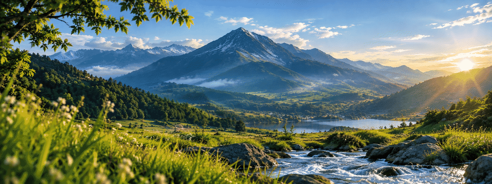

 

Reno Fadila Kurniawan

📍 Malang, Indonesia

Software Engineering Student · Keep Learning, Keep Growing

  
  
  

  
  

---

## 👋 About Me

Hi! I'm **Reno Fadila Kurniawan**, a student at **SMKN 6 Malang**, majoring in Software Engineering (RPL).

I'm passionate about technology, programming, and building applications that solve real-world problems. I enjoy exploring new technologies, improving my coding skills, and turning ideas into working projects.

* 🎓 **Education:** SMKN 6 Malang
* 💻 **Major:** Software Engineering (RPL)
* 📍 **Location:** Malang, Indonesia
* 🚀 **Interests:** Software Development, Web Development, and Desktop Applications
* 🎮 **Hobbies:** Coding and Gaming
* 🌱 **Currently:** Learning, building projects, and improving my development skills

## 🛠️ Tech Stack

## 📊 GitHub Statistics

## 🚀 Featured Projects

I'm always interested in developing new projects, experimenting with ideas, and learning from the developer community.

## 🎯 Goals

* Build useful and creative applications.
* Improve my problem-solving and programming skills.
* Learn new frameworks and development technologies.
* Create projects that demonstrate my abilities as a developer.
* Collaborate with other developers and learn from their experience.

## 🤝 Connect With Me

  

**Thanks for visiting my profile!** 💙

*Keep learning, keep building, and keep improving.* 🚀

